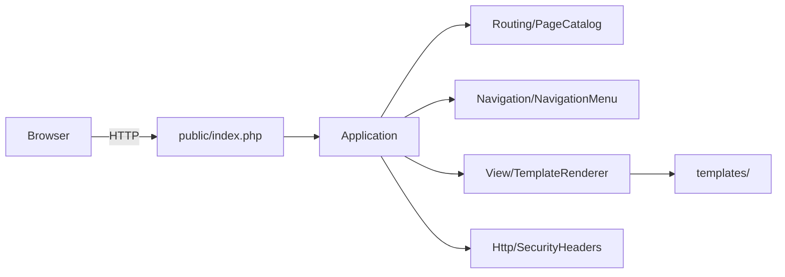

# Architecture

## Overview

nav2018 is a server-rendered PHP application with no runtime dependencies beyond PHP and the Composer autoloader.



## Module structure

```text
public/
  index.php                  Front controller and last-resort error boundary
  assets/site.css            Stylesheet
src/
  Application.php            Maps a request to a response
  Http/
    Request.php              Method and path normalization
    Response.php             Status, headers, body, and output
    SecurityHeaders.php      Shared response headers
  Navigation/
    NavigationLink.php       Immutable link view model
    NavigationMenu.php       Derives links and the active state
  Routing/
    Page.php                 Immutable page definition
    PageCatalog.php          Single source of truth for pages
  View/
    Html.php                 Contextual HTML escaping
    TemplateRenderer.php     Renders validated template names
templates/
  layout.php
  partials/navigation.php
tests/
  Unit/  Integration/  Functional/  Database/
```

## Request flow

1. `public/index.php` builds a `Request` from the server variables.
2. `Application` rejects methods other than `GET` and `HEAD`.
3. `PageCatalog` resolves the normalized path against a fixed list.
4. `NavigationMenu` builds links and marks the active one.
5. `TemplateRenderer` produces escaped HTML.
6. `Response` sends the status, security headers, and body.

## Design decisions

- **One catalog.** Routes and navigation cannot drift apart because both come from `PageCatalog`.
- **Front controller.** When `public/` is the document root, source and templates are not directly addressable.
- **No framework.** Four static routes do not justify a runtime dependency.
- **No frontend/backend split.** There is no client-side application or API to separate.
- **No runtime database.** The site has no persistent domain data; `db/schema.sql` is optional and stores test results only.

## Recommended deployment

Run PHP-FPM behind a reverse proxy that terminates TLS, sets HSTS, applies rate limits, adds the security headers to static files, and uses `public/` as its document root.
